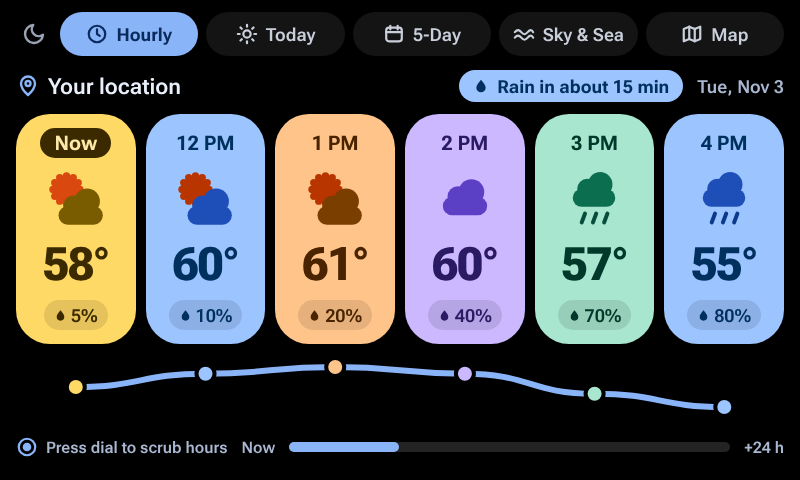
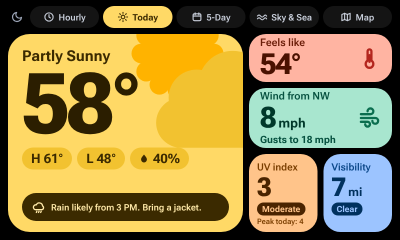
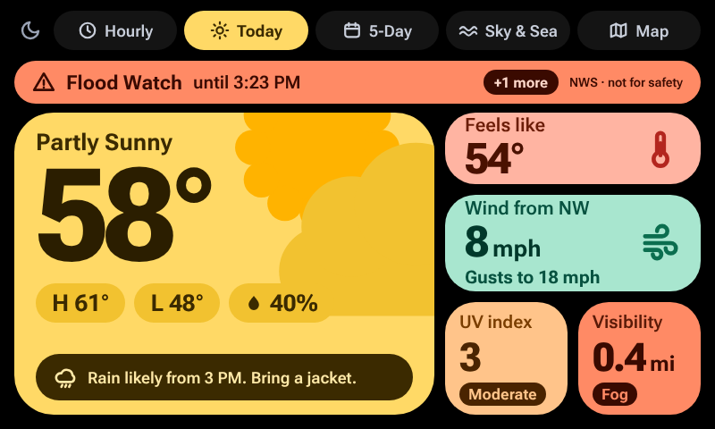
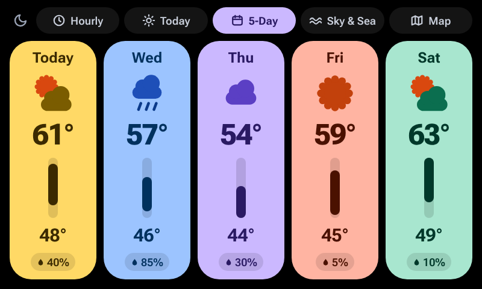
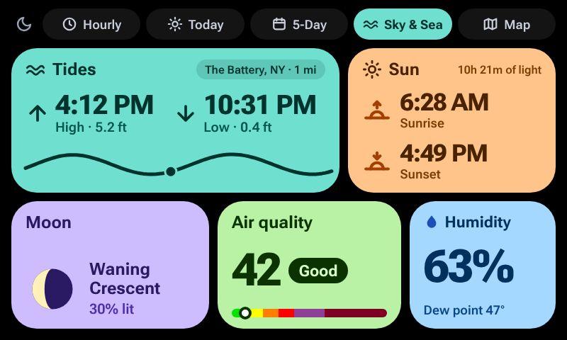
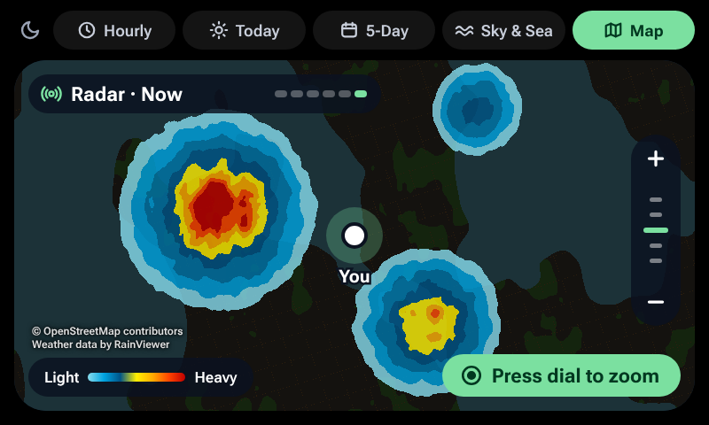
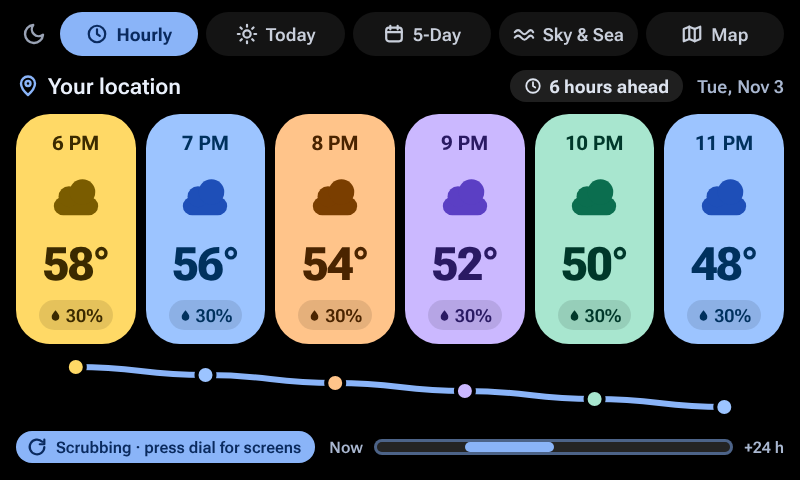
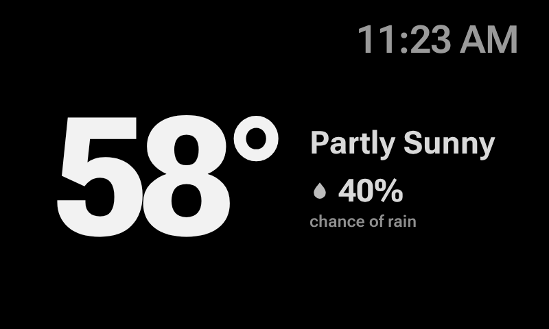

# Dash Weather

A weather station for the discontinued Spotify Car Thing, running on [bridgething](https://bridgething.com). Five screens,
in bright Material 3 Expressive colors on a black background. It is free, has no accounts, API keys or tracking, and is
open source.

> Built by Thomas Marlowe with help from Claude, an AI tool from Anthropic. See [how this was built](docs/how-this-was-built.md).

**Not for navigation or safety.** This screen is made to be glanced at in a car, and the weather data is a best guess from
free services. Do not use it to decide whether a road, a trip or a storm is safe. Weather alerts on the screen can be late
or missing.

## Screenshots

All of these are **simulated**: the app drawn in a browser with made-up weather and a fixed place in New York, not photos of
a real Car Thing. Screenshots from a real device will replace them once version 0.2.0 has been tried on one.

<table>
  <tr>
    <td align="center">
       
      <b>Hourly</b> (button 1), simulated
    </td>
    <td align="center">
       
      <b>Today</b> (button 2), simulated
    </td>
  </tr>
  <tr>
    <td align="center">
       
      <b>Today with an alert and fog</b>, simulated
    </td>
    <td align="center">
       
      <b>5-Day</b> (button 3), simulated
    </td>
  </tr>
  <tr>
    <td align="center">
       
      <b>Sky &amp; Sea</b> (button 4), simulated
    </td>
    <td align="center">
       
      <b>Map</b> (recessed button), simulated
    </td>
  </tr>
  <tr>
    <td align="center">
       
      <b>Hourly, scrubbing 6 hours ahead</b>, simulated
    </td>
    <td align="center">
       
      <b>Standby</b>, simulated (the real device also lowers its backlight, which a screenshot cannot show)
    </td>
  </tr>
</table>

## The five screens

| Control         | Screen    | What it shows                                                                                       |
| --------------- | --------- | --------------------------------------------------------------------------------------------------- |
| Button 1        | Hourly    | Now plus the next five hours: temperature, sky, chance of rain. "Rain in about 15 min" when it is close |
| Button 2        | Today     | Temperature, high and low, chance of rain, feels like, wind and gusts, UV index, visibility, a tip. A banner for US weather alerts |
| Button 3        | 5-Day     | Five days: sky, high and low, chance of rain                                                        |
| Button 4        | Sky & Sea | Tides, sunrise and sunset, moon phase, air quality, humidity                                        |
| Recessed button | Map       | Rain radar over a street map. The last hour of radar loops, with the age of each frame               |

## Controls

- **Dial turn** switches screens, on every screen, and wraps around. "Reverse the dial" in settings flips the direction.
- **Dial click** on Hourly and on Map gives the dial a second job: scrubbing the next 24 hours one hour per notch on Hourly,
  zooming on Map. The screen says which job is active. It goes back to switching screens after about 10 seconds without a
  turn, or on another click. On the other three screens the dial click does nothing.
- **Back button**: not used.
- **Touch**: tap a pill along the top to switch screens.
- **Pin icon** (top left, next to the moon, only when a second place is set): flips every screen between your location and the second place.
- **Moon icon** (top left): dims or brightens the screen by hand.

## Other features

- **Second place:** set a name and coordinates in settings, then tap the pin to look at that place instead of where you are.
- **Dimming:** the moon dims by hand. "Dim at night" (off by default) dims by itself between sunset and sunrise at the place
  on screen and brings the light back at sunrise, but only if it was this app that dimmed it.
- **Standby:** optional (off by default). After 1, 2, 5, 10 or 30 quiet minutes the screen shows only the temperature, sky
  and chance of rain, white on black, with an optional clock. Any press or touch wakes it and does nothing else. It also
  lowers the backlight, never raising a screen that is already dimmer.
- **Alerts:** US National Weather Service alerts for your place, shown on Today. United States only.

## What you need

- A Car Thing running bridgething 0.16.0 or newer.
- The bridgething companion app on your phone, signed in to the internet, with location allowed. The phone does all the
  networking for the Car Thing.
- For tides: a US coast or territory. Tide data comes from NOAA, which only covers the United States and its territories.
  Everywhere else the Tides card says there is no station nearby and the rest of the screen still works.
- For alerts: a place in the United States or its territories. Elsewhere no alerts are asked for and no banner appears.

Everything else (forecast, radar, air quality, sun, moon) works worldwide.

## Install

See [docs/install.md](docs/install.md). Short version: install it from the bridgething store once it is listed, or paste the
address of the version zip into the companion app's "install from url or file" panel (not yet tested on a real device).

- Catalog address, which the store reads: `https://tomarlowe.github.io/dash-weather/catalog.v1.json`
- Zip for version 0.2.0: `https://tomarlowe.github.io/dash-weather/r/01a1a417-eafb-71c3-b41e-70de98fc1cb7/0.2.0.zip`
  (this address works once 0.2.0 is published)

## Known limits

- **Rain soon is much less exact outside North America and central Europe.** The 15-minute rain figures come straight from
  weather models there. Elsewhere the service fills them in from hourly data, so "Rain in about 15 min" can be off by a lot
  or miss a short shower. Even in the best areas it is a forecast rounded to 5 minutes, not a radar nowcast.
- **Alerts can be late or missing.** They come from the National Weather Service's public service, which does not promise
  timeliness. A list that could not be refreshed for an hour is hidden. Never rely on this screen for safety.
- Tides cover the United States and its territories only, and are predictions, not measurements.
- Radar goes no closer than zoom 7, so the closest map zoom steps look blocky.
- The radar loop downloads up to six radar pictures for the map on screen. How that feels over the phone link has not been
  measured on a real device.
- Dimming and standby change the real screen backlight through bridgething. Whether the device accepts that, and whether
  the light always comes back, has not been checked on a real device.
- The wheel click and the exact number of dial events per notch are assumed from bridgething's documentation, not observed.

## What has been tested

- **Simulated, by Claude, with made-up data:** 183 automatic tests (type checks and unit tests), and a scripted run in a
  browser simulator that pressed the buttons and dial and checked the screens. These test the app's logic. They do not
  prove anything about the live services or a real Car Thing.
- **On a real Car Thing:** only what [the device checklist](docs/device-test-checklist.md) shows ticked, and those ticks
  are Thomas's. Version 0.2.0 has not been tried on a real device yet.

## Documentation

- [Install guide](docs/install.md)
- [User guide](docs/user-guide.md): every screen, every setting
- [Troubleshooting](docs/troubleshooting.md)
- [Privacy](docs/privacy.md): what leaves the device
- [Data sources, credits and terms](docs/data-sources.md)
- [Architecture](docs/architecture.md)
- [Design decisions](docs/design-decisions.md), and who made them
- [Testing](docs/testing.md)
- [Roadmap](docs/roadmap.md)
- [FAQ](docs/faq.md)
- [How this was built](docs/how-this-was-built.md)
- [Contributing](CONTRIBUTING.md), [Code of conduct](CODE_OF_CONDUCT.md), [Security policy](SECURITY.md), [Third-party notices](THIRD_PARTY_NOTICES.md)
- [Developer guide](docs/developer-guide.md): build it, change it, test it, ship it
- [Device test checklist](docs/device-test-checklist.md)
- [Changelog](apps/dash-weather/CHANGELOG.md)

## Privacy

There is no account, no tracking and no analytics, and nothing is sent to the author. The forecast, air quality and alert
services receive your location rounded to about 1 kilometer. The map services receive the map squares you look at. Full
detail in [docs/privacy.md](docs/privacy.md).

## Credits

- Forecast and air quality: [Open-Meteo.com](https://open-meteo.com/) (air quality data from Copernicus CAMS), CC BY 4.0
- Alerts: [National Weather Service](https://www.weather.gov/) (api.weather.gov). Not endorsed by or affiliated with NOAA or
  the NWS.
- Tides: NOAA CO-OPS
- Radar: [Weather data by RainViewer](https://www.rainviewer.com/)
- Map: © OpenStreetMap contributors
- Fonts: [Roboto Flex](https://github.com/googlefonts/roboto-flex), SIL Open Font License
- Platform: [bridgething](https://bridgething.com)

## License

[MIT](LICENSE). The data services above have their own terms, summarized in
[docs/data-sources.md](docs/data-sources.md). The free tiers they offer are for non-commercial use.
