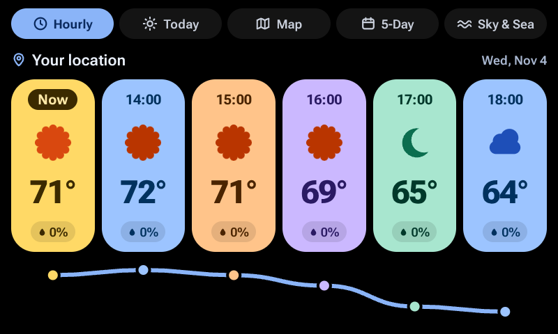
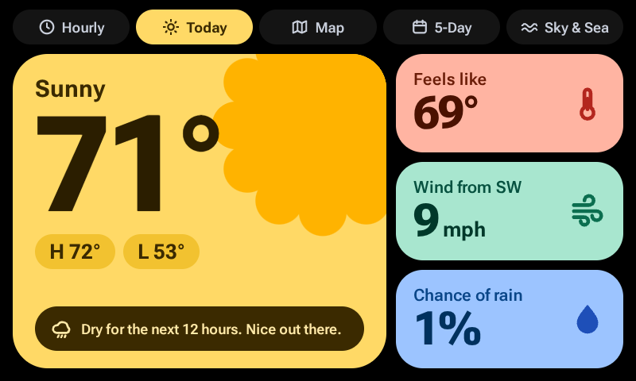
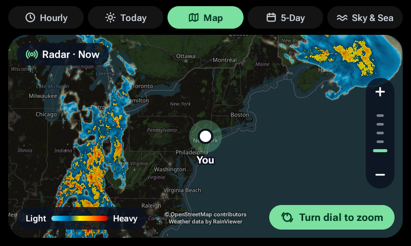
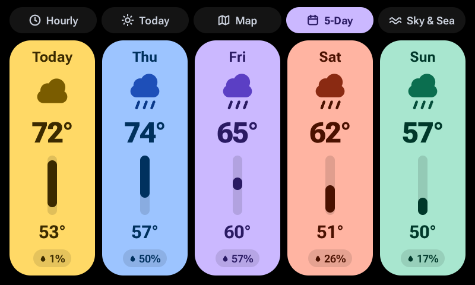
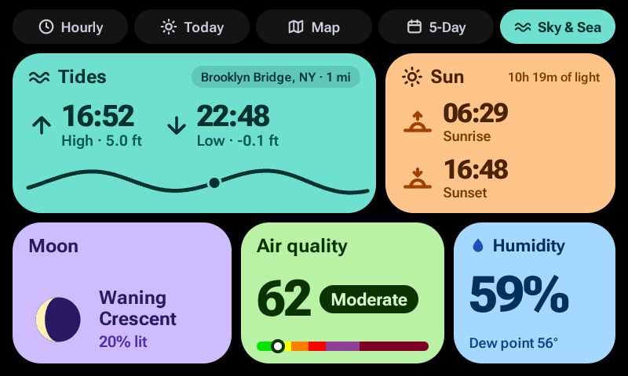

# Dash Weather

A weather station for the discontinued Spotify Car Thing, running on [bridgething](https://bridgething.com). Five screens,
one for each button, in bright Material 3 Expressive colors on a black background. It is free, has no accounts or API
keys, and is open source.

## Screenshots

<table>
  <tr>
    <td align="center">
       
      <b>Hourly</b> (button 1)
    </td>
    <td align="center">
       
      <b>Today</b> (button 2)
    </td>
  </tr>
  <tr>
    <td align="center">
       
      <b>Map</b> (button 3)
    </td>
    <td align="center">
       
      <b>5-Day</b> (button 4)
    </td>
  </tr>
  <tr>
    <td align="center">
       
      <b>Sky &amp; Sea</b> (recessed button)
    </td>
    <td></td>
  </tr>
</table>

The screenshots show Location set to a fixed place in New York, with the 24-hour clock.

## The five screens

| Button          | Screen    | What it shows                                                                    |
| --------------- | --------- | -------------------------------------------------------------------------------- |
| 1               | Hourly    | Now plus the next five hours: temperature, sky, chance of rain                   |
| 2               | Today     | Current temperature, high and low, feels like, wind, chance of rain, a one-line tip |
| 3               | Map       | Live rain radar over a street map. Turn the dial to zoom                         |
| 4               | 5-Day     | Five days: sky, high and low, chance of rain                                     |
| Recessed button | Sky & Sea | Tides, sunrise and sunset, moon phase, air quality, humidity                     |

The dial click and the back button are deliberately unused, so they stay free for actions that work across all your
bridgething apps.

## What you need

- A Car Thing running bridgething 0.16.0 or newer.
- The bridgething companion app on your phone, signed in to the internet, with location allowed. The phone does all the
  networking for the Car Thing.
- For tides: a US coast or territory. Tide data comes from NOAA, which only covers the United States and its territories.
  Everywhere else the Tides card says there is no station nearby and the rest of the screen still works.

Everything else (forecast, radar, air quality, sun, moon) works worldwide.

## Install

See [docs/install.md](docs/install.md). Short version: install it from the bridgething store once it is listed, or paste the
address of the version zip into the companion app's "install from url or file" panel (not yet tested on a real device).

- Catalog address, which the store reads: `https://tomarlowe.github.io/dash-weather/catalog.v1.json`
- Zip for version 0.1.0: `https://tomarlowe.github.io/dash-weather/r/01a1a417-eafb-71c3-b41e-70de98fc1cb7/0.1.0.zip`

## Documentation

- [Install guide](docs/install.md)
- [User guide](docs/user-guide.md): every screen, every setting
- [Troubleshooting](docs/troubleshooting.md)
- [Data sources, credits and terms](docs/data-sources.md)
- [Developer guide](docs/developer-guide.md): build it, change it, test it, ship it
- [Device test checklist](docs/device-test-checklist.md)
- [Changelog](apps/dash-weather/CHANGELOG.md)

## Privacy

There is no account, no tracking and no analytics. The forecast and air quality services receive your location rounded to
about 1 kilometer. The map services receive the map squares you look at. Nothing is sent to the author. Details in
[docs/data-sources.md](docs/data-sources.md).

## Credits

- Forecast and air quality: [Open-Meteo.com](https://open-meteo.com/) (air quality data from Copernicus CAMS), CC BY 4.0
- Tides: NOAA CO-OPS
- Radar: [Weather data by RainViewer](https://www.rainviewer.com/)
- Map: © OpenStreetMap contributors
- Fonts: [Roboto Flex](https://github.com/googlefonts/roboto-flex), SIL Open Font License
- Platform: [bridgething](https://bridgething.com)

## License

[MIT](LICENSE). The data services above have their own terms, summarized in
[docs/data-sources.md](docs/data-sources.md). The free tiers they offer are for non-commercial use.
