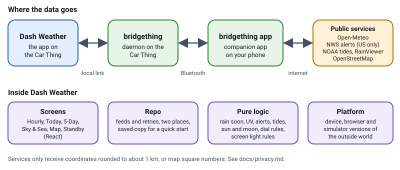

# Architecture

Dash Weather is one web page, 800 by 480 pixels, running full screen in the Car Thing's kiosk browser. It has no server of
its own. Everything it shows comes from public services, reached through the bridgething daemon on the Car Thing and the
bridgething companion app on your phone, which does all the networking. This page is the short version. The
[developer guide](developer-guide.md) goes file by file.

## The four parts of the app

| Part | Where | What it does |
| ---- | ----- | ------------ |
| Screens | `src/ui/` | Draws Hourly, Today, 5-Day, Sky & Sea, Map and the standby screen from the data it is given. It holds no data of its own |
| Repo | `src/data/repo.ts` | Owns every feed (forecast, air quality, tides, radar, alerts), your location, refresh timing, retries, the second place and the small saved copy that lets screens fill in at once |
| Pure logic | `src/data/*.ts`, `src/controls.ts`, `src/dim.ts` | Plain functions with no screen and no network: reading each service's reply, units, rain soon, UV, visibility, sun and moon, the dial and button rules, the rules for who wants the screen dim. This is the part the unit tests cover best |
| Platform | `src/platform/`, `src/sim/` | The only code that touches the outside world: fetching, saved values, settings, position, the backlight. There is a device version, a plain browser version and a simulator version with made-up data, so the rest of the app never knows which one it runs on |

## One rule that shapes everything

The screens and the logic never ask "where am I running?". Only the platform part does. That is why the app can be run and
checked in a browser with made-up data, and why most behavior can be tested without a Car Thing. It is also why a passing
simulated test says nothing about the real device: the part that differs is exactly the part the simulator replaces.

## What happens when you do things

- **A refresh timer ticks.** The Repo asks each feed whether it is due (forecast 15 minutes, air quality 30, alerts 5,
  radar 5, tides 6 hours), fetches what is due, and tells the screens. A failed fetch is retried quickly when nothing answered
  at all, and slowly when a service answered with an error.
- **You turn the dial.** `src/input.ts` turns the raw wheel events into one step per notch and hands it to the rules in
  `src/controls.ts`, which decide whether that is a new screen, a zoom step or an hour of scrubbing.
- **You tap the pin.** The Repo keeps both places' data and switches which one is on screen. A reply that was asked for before
  the switch is thrown away when it arrives.
- **You tap the moon, or night falls, or standby starts.** All three ask one `Dimmer` to lower the backlight. It remembers what
  the light was, and puts it back only if the light is still where the app left it.

## What is stored

A small saved copy on the Car Thing (last position, forecast for your own place, air quality, tide stations and predictions)
so the screens are not empty at start. Map squares are only kept in memory. Settings live in bridgething. Nothing is sent to
the author. See [privacy.md](privacy.md).

## Limits of this design

- One page and one process: if the daemon link drops, the app can only show its saved copy and say "Offline".
- The Repo trusts each service's documented reply format, and stays quiet rather than guessing when a field is missing.
- The screen light depends on bridgething's hardware calls, which the app uses on trust (see
  [testing](testing.md) and the [device checklist](device-test-checklist.md)).
